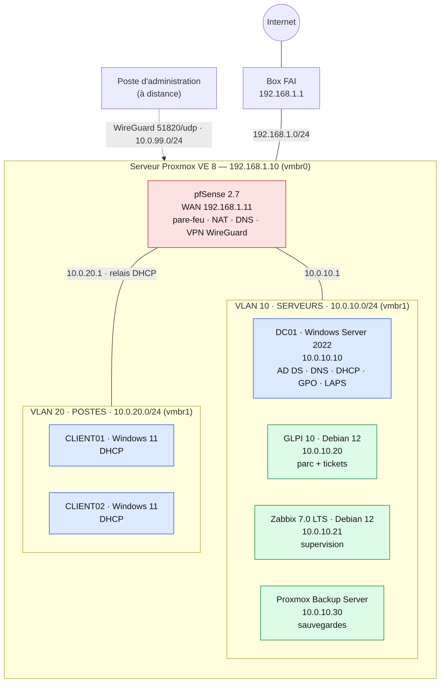

# Homelab MSP — Infogérance sur Proxmox

[](https://github.com/ebarrault/Homelab-MSP/actions/workflows/ci.yml)

Reproduction, sur un seul serveur Proxmox, de l'infrastructure informatique type d'une PME infogérée : **annuaire Active Directory** avec **GPO**, **DNS** et **DHCP**, **pare-feu pfSense** avec réseaux séparés et **VPN**, **GLPI** pour le parc et les tickets, **Zabbix** pour la supervision, **sauvegardes** testées avec Proxmox Backup Server. Tout est **scripté**, **documenté**, avec des **procédures d'exploitation** et une **page de tests**.



## Ce que le labo démontre

| Compétence | Mise en œuvre |
|---|---|
| Virtualisation | Proxmox VE 8 : ponts réseau, VLAN, VirtIO, UEFI/TPM, ordre de démarrage, création des VM par script (`qm`) |
| Réseau et sécurité | pfSense : 2 VLAN + VPN, **segmentation stricte** (règles par flux, refus par défaut, journalisation), NAT, DNS Resolver, relais DHCP, **WireGuard** |
| Windows Server | AD DS, DNS (zones inverses, redirecteurs, nettoyage), DHCP autorisé dans l'AD, **7 GPO** (sécurité, mises à jour, lecteurs, administrateurs locaux), **Windows LAPS**, PSO pour les administrateurs, AGDLP, partages avec ABE |
| Gestion de parc / ITSM | GLPI 10 : authentification AD, habilitations par groupe, **inventaire automatique par agent**, tickets avec SLA |
| Supervision | Zabbix 7.0 LTS : modèles Windows/Linux/AD/pfSense/Proxmox, **auto-enregistrement configuré par l'API**, alertes mail/Teams |
| Sauvegarde | PBS : sauvegardes nocturnes dédupliquées, rétention, vérification, **3-2-1**, état système AD, **restaurations testées et chronométrées** |
| Linux | Debian 12 durcie : SSH par clé, ufw, fail2ban, mises à jour automatiques, NTP sur le DC |
| Exploitation | [procédures](docs/procedures.md) de résolution d'incidents, gestion des mises à jour, ajout d'un poste |

## Guide de construction

| Étape | Document | Scripts |
|---|---|---|
| Plan d'adressage, dimensionnement | [plan-adressage.md](docs/plan-adressage.md) | |
| 1. Proxmox, réseau, VM | [01-proxmox.md](docs/01-proxmox.md) | `scripts/proxmox/create-vms.sh`, `network-interfaces.example` |
| 2. pfSense | [02-pfsense.md](docs/02-pfsense.md) · [règles](config/pfsense/regles-pare-feu.md) | |
| 3. AD, DNS, DHCP, GPO | [03-active-directory.md](docs/03-active-directory.md) | `scripts/windows/01` à `06` |
| 4. GLPI | [04-glpi.md](docs/04-glpi.md) | `scripts/linux/harden-debian.sh`, `install-glpi.sh` |
| 5. Zabbix | [05-zabbix.md](docs/05-zabbix.md) | `install-zabbix.sh`, `zabbix-autoregistration.sh` |
| 6. Sauvegardes | [06-sauvegardes.md](docs/06-sauvegardes.md) | `scripts/proxmox/backup-jobs.sh`, `06-Backup-SystemState.ps1` |
| Exploitation | [procedures.md](docs/procedures.md) | |
| Recette | [tests.md](docs/tests.md) — 18 tests | |

Matériel : un PC ou mini-PC avec 6 cœurs, 32 Go de RAM et un SSD de 1 To (fonctionne avec 16 Go en réduisant le nombre de postes). Logiciels : versions gratuites ou d'évaluation (Windows Server 2022 évaluation 180 jours, Proxmox sans abonnement).

## Flux autorisés (extrait)

| De | Vers | Autorisé | Interdit |
|---|---|---|---|
| Postes (VLAN 20) | DC01 | services AD (Kerberos, LDAP, DNS, SMB, RPC, NTP) | — |
| Postes | GLPI / Zabbix | HTTPS / agent actif 10051 | SSH, administration |
| Postes | autres serveurs, Proxmox, PBS | — | **tout** |
| Serveurs (VLAN 10) | Postes | agent Zabbix 10050 depuis ZABBIX uniquement | **tout le reste** |
| VPN d'administration | Serveurs, Proxmox | SSH, RDP, HTTPS, 8006 | — |
| Internet | labo | WireGuard 51820/udp | tout le reste |

## Organisation du dépôt

```
docs/                     guides par étape, procédures, page de tests, schéma (source Mermaid)
config/pfsense/           alias et règles de pare-feu
scripts/proxmox/          réseau, création des VM, tâches de sauvegarde
scripts/windows/          DC, DNS/DHCP, AD, GPO + LAPS, agents, sauvegarde état système
scripts/linux/            durcissement Debian, GLPI, Zabbix, auto-enregistrement (API)
```

La CI vérifie les scripts à chaque push : **ShellCheck**, exécution à blanc de la création des VM, **PSScriptAnalyzer** sur un runner Windows.

## Liens avec les autres projets

- [Réseau PME Cisco](https://github.com/ebarrault/Lab-Cisco-PME) : même logique de segmentation, sur matériel Cisco.
- [Automatisation AD et Microsoft 365](https://github.com/ebarrault/AccessFlow) : les arrivées et départs se branchent directement sur ce domaine.
- [Supervision réseau](https://github.com/ebarrault/NetWatch) et [Inventaire de parc](https://github.com/ebarrault/ParcIT) : les mêmes besoins, développés sur mesure, à comparer avec Zabbix et GLPI.

## Évolutions prévues

Second contrôleur de domaine (DC02) · autorité de certification interne (LDAPS, certificats GLPI/Zabbix) · WSUS · Microsoft Entra Connect vers un tenant de test · Graylog pour centraliser les journaux.
